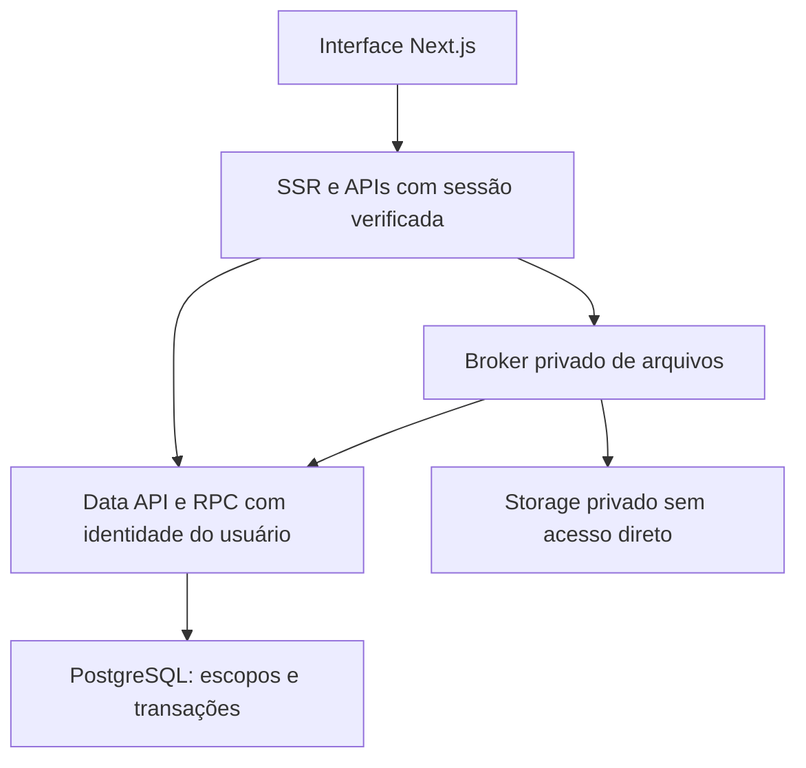

# Arquitetura e decisões

## Fontes de verdade e autorização

Next.js executa SSR, formulários e APIs. Supabase Auth mantém a sessão em cookies pelos helpers oficiais. O servidor chama `auth.getUser()` nas operações protegidas; RLS e RPC consultam associação ativa no banco. Papel na URL ou função no jogo nunca autoriza acesso. O cliente administrativo fica restrito ao broker de arquivos e à manutenção controlada.

`execute_command` apenas despacha para funções de domínio e armazena recibos de idempotência. Validação Zod confere formato; as invariantes são implementadas no banco. Dados reais não usam localStorage nem backend fictício. `/demonstracao` é uma área separada, identificada e somente leitura.

## Domínios das migrações

| Migração | Responsabilidade |
| --- | --- |
| 001 | Perfis, times, membros, funções por mapa/lado, convites, auditoria e notificações |
| 002 | Biblioteca, sessões, exercícios, resultados, presença, metas, disponibilidade e playbook |
| 003 | Mural, versões, scrims, reservas, sala, placares e moderação |
| 004 | Metadados de arquivos, revisão, vínculos privados, bucket e fechamento de grants |
| 005 | Dispatch e idempotência sem persistir token de convite no recibo |
| 006 | Edição de checklist autorizada pela sessão |
| 007 | Correção do gatilho para campos que não existem em todos os registros |
| 008 | Revanche privada usando a mesma negociação |
| 009 | Atividade de upload e limpeza serializada com autorização de partes |

## Estados

| Recurso | Estados e regra |
| --- | --- |
| Sessão | `pending`, `in_progress`, `completed`, `cancelled`, `archived`. Presença, resultado e checklist são independentes. Cópias começam pendentes. |
| Convite | Pendente até uso, expiração ou revogação. O aceite exige destinatário verificado e cria associação na mesma transação. |
| Vaga | `open → consumed` no primeiro aceite; pode ser fechada ou moderada. Revanche usa vaga privada. |
| Negociação | `pending → accepted / declined / withdrawn / expired`. Contraproposta cria versão nova; só o outro time aceita a corrente. |
| Scrim | `confirmed → completed` por acordo dos relatos; ou `confirmed → cancelled` por representante. Confirmada não significa jogada. |
| Remarcação | `pending → accepted / declined / superseded`. A reserva original só muda após aceite e nova reserva bem-sucedida. |
| Demo | `pending → ready` após verificação do tamanho pelo broker; `failed → pending` na retomada. Link externo não hospeda bytes. |
| Revisão | `open / applied / archived`; criar treino preserva escopo e referência de origem. |
| Playbook | `testing / ready / needs_review / archived`; arquivar conserva os dados. |

## Concorrência e idempotência

Aceites bloqueiam vaga e negociação, validam o número da versão, prazo e representante. Locks dos dois times seguem ordem estável. Reservas ativas usam a exclusão GiST `(team_id =, slot &&)` com intervalo `[início,fim)`. A operação é uma transação: conflito reverte scrim, ambas as reservas, consumo da vaga e notificações.

Remarcação atualiza as duas reservas juntas; uma falha conserva as originais. Scrims, bloqueios explícitos e sessões coletivas bloqueantes usam a mesma restrição. Disponibilidade individual é informativa.

Repetir o aceite retorna a scrim existente. Formulários mantêm uma chave por payload e geram outra ao editar. Reutilizar chave com conteúdo diferente é rejeitado. O token de convite só é retornado na primeira resposta e não vai para o recibo; resposta perdida exige novo convite e revogação do anterior.

## Privacidade de relações e arquivos

Solo usa titular próprio e `team_id IS NULL`. Time usa associação ativa. Não há escrita direta de usuário nas tabelas do domínio. RPCs, FKs, constraints e gatilhos impedem trocar propriedade ou ligar revisão/demo/tarefa a outro escopo.

Diretório público e mural são intencionalmente separados de elenco, instruções de sala e documentos privados. Participar de uma scrim nunca concede acesso ao playbook, revisão ou demo do adversário.

O broker resolve o objeto por metadados autorizados, não por prefixo do cliente. Cada parte TUS atualiza atividade sob lock; a limpeza adquire o mesmo lock e recusa uploads retomados recentemente. O download faz streaming sem URL assinada ou cache compartilhado. Objetos concluídos não são apagados pelo script de limpeza. Links externos só são abertos pelo usuário e não são incorporados ou baixados automaticamente.

## Limites da implementação

A consulta atual usa janelas de até 200 sessões e 2.000 resultados, com amostra informada. Para histórico maior, ampliar paginação/consulta por período antes de tratar a métrica como histórico integral. O broker adiciona consultas e um salto de rede para preservar a revogação na próxima solicitação. O limite local de 500 MiB precisa ser conciliado com o plano e proxy reais. `.dem` é um anexo: não há player ou parsing automático.
